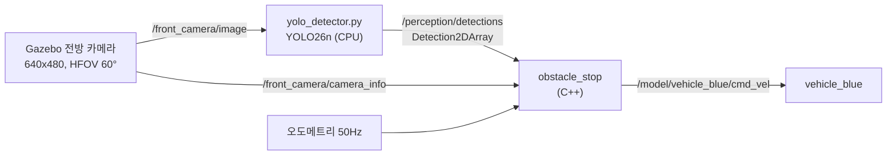

# ros2-vehicle-control

ROS2 Humble + Gazebo Fortress 환경에서 차동구동 차량(`vehicle_blue`)을 제어하는 패키지입니다.
- **제어**: 오도메트리 기반 거리 주행, P제어 감속 정지, 안전 정지(fail-safe)
- **인식**: 전방 카메라 → YOLO 객체 검출 → 단안 거리 추정 → 내 차선의 장애물 앞에서 감속·정지

## 환경
- Ubuntu 22.04 (arm64, UTM VM on Apple Silicon)
- ROS2 Humble, Ignition Gazebo Fortress, ros_gz_bridge, vision_msgs
- C++17 (rclcpp), Python 3 (rclpy, Ultralytics YOLO26n, CPU 추론)

## 구성
| 파일 | 설명 |
|---|---|
| `src/circle_driver.cpp` | 타이머로 Twist를 발행해 원 주행, Ctrl+C 시 정지 명령 후 종료 |
| `src/drive_distance.cpp` | 오도메트리 구독 → 목표 거리까지 P제어 감속 주행 후 정지 |
| `src/obstacle_stop.cpp` | 검출 결과 → 단안 거리 추정·차선 필터 → 장애물 앞 P제어 정지 |
| `scripts/yolo_detector.py` | 카메라 이미지 → YOLO 검출 → `vision_msgs/Detection2DArray` 발행 |
| `scripts/red_box_detector.py` | 검증용: 빨간 상자를 검출하는 가짜 인식 노드 (정답 거리 실험용) |
| `launch/sim.launch.py` | Gazebo + ROS↔Gazebo 브리지 실행 |
| `launch/perception.launch.py` | 인식 데모: Gazebo + 브리지(카메라 포함) + 검출 + 정지 노드 + 결과 영상 창 |
| `worlds/diff_drive.sdf` | Fortress 데모 월드 수정본 (오도메트리 1Hz → 50Hz) |
| `worlds/perception_road.sdf` | 도로·차선 + 전방 카메라 + 주차된 차·보행자 (Gazebo Fuel 모델) |
| `worlds/distance_test.sdf` | 거리 검증용: 정답 위치를 아는 빨간 상자 (인터넷 불필요) |

## 실행

### 1. 거리 주행
```bash
cd ~/ros2_ws/src && git clone git@github.com:ParkGyeom/ros2-vehicle-control.git vehicle_control
cd ~/ros2_ws && colcon build --packages-select vehicle_control --symlink-install
source install/setup.bash

# 터미널 1: 시뮬레이션
ros2 launch vehicle_control sim.launch.py
# 터미널 2: 거리 주행
ros2 run vehicle_control drive_distance --ros-args -p target_distance:=2.0 -p kp:=1.5
```

파라미터: `target_distance`(m), `max_speed`(m/s, 로봇 한계 0.5로 clamp), `min_speed`, `kp`, `tolerance`

### 2. 인식 → 장애물 정지
```bash
# 의존성 (한 번만)
sudo apt install ros-humble-vision-msgs ros-humble-rqt-image-view python3-pip
pip3 install --user ultralytics "numpy<2"

cd ~/ros2_ws && colcon build --packages-select vehicle_control --symlink-install
source install/setup.bash
ros2 launch vehicle_control perception.launch.py drive:=true
```
- `numpy<2`: Humble의 파이썬 메시지 모듈이 numpy 1.x로 빌드돼 있어, pip이 numpy 2를 깔면 메시지 import가 깨집니다.
- 처음 실행할 때는 Gazebo Fuel에서 차·보행자 모델을, Ultralytics가 YOLO 가중치를 내려받느라 시간이 걸립니다.

시나리오 (`perception_road.sdf`, 내 차선 중심 y=2):
1. 인도 위 보행자는 검출되지만 차선 밖이라 무시하고 주행
2. 내 차선에 주차된 차 앞 3 m에서 감속·정지 (HOLD)
3. 차를 옆 차선으로 치우면 다시 출발
   ```bash
   ign service -s /world/perception_road/set_pose \
     --reqtype ignition.msgs.Pose --reptype ignition.msgs.Boolean --timeout 2000 \
     --req 'name: "parked_car", position: {x: 15, y: -2.5, z: 0}'
   ```
4. 차선 안에 서 있는 보행자 앞에서 다시 정지

| launch 인자 | 기본값 | 설명 |
|---|---|---|
| `drive` | `false` | `true`면 `obstacle_stop` 실행 (차가 움직임) |
| `gui` | `true` | `false`면 Gazebo 창 없이 실행 → VM에서 카메라 FPS 상승 |
| `imgsz` | `640` | YOLO 입력 해상도, 느리면 `320` |
| `model` | `yolo26n.pt` | YOLO 가중치 |
| `image_view` | `true` | 박스를 그린 결과 영상 창 (`/perception/image_annotated`) |
| `world` | `perception_road.sdf` | `worlds/` 안의 파일 이름 또는 절대 경로 |
| `detector` | `yolo` | `red_box`: 검증용 빨간 상자 검출기 |
| `odom_prediction` | `true` | 지연 보상 on/off (비교 실험용) |

`obstacle_stop` 주요 파라미터: `stop_distance`(3.0 m), `camera_height`(0.7 m), `lane_half_width`(1.2 m), `kp`(0.5), `cruise_speed`(1.5 m/s, 최대 2.0), `detection_timeout`(1.5 s), `clear_frames`(3), `resume_margin`(0.3 m). 실수 파라미터는 `3.0`처럼 소수점을 붙여서 넘깁니다.

## 인식 파이프라인



### 단안 거리 추정 (ground-plane)
카메라가 바닥에서 높이 `h`에 수평으로 달려 있고 바닥이 평평하다고 가정하면, 바닥 위의 점이 이미지의 `v`행에 보일 때
```
전방 거리 Z = fy · h / (v − cy)
좌우 위치 X = (u − cx) · Z / fx
```
물체가 바닥에 닿는 곳은 검출 박스의 **아랫변**이므로, 아랫변으로 거리와 좌우 위치를 구합니다. `fx, fy, cx, cy`는 `camera_info`의 K 행렬에서 읽습니다.
- 박스 아랫변이 지평선(`cy`) 위 → 바닥 접점이 안 보이므로 거리 계산에서 제외
- 박스가 이미지 아래로 잘림 → 실제로는 추정보다 가까우므로 거리 0(즉시 정지)으로 처리
- 가정이 깨지는 경우: 경사로, 차체 피치(가감속), 바닥에 닿지 않은 물체

### 차선 필터
박스 아랫변 양 끝의 좌우 위치 `[X_left, X_right]`가 내 진행 폭(±`lane_half_width`)과 겹칠 때만 장애물로 봅니다. 그중 가장 가까운 것 하나로 속도를 정합니다.

### 인식 지연 보상
YOLO 결과는 이미지를 찍은 뒤 수백 ms 늦게 도착하므로, 그동안 차가 이동한 만큼 실제 거리는 더 짧습니다.
오도메트리의 (sim 시각, 누적 주행거리)를 기록해 두고 `지금 거리 = 측정 거리 − (현재 누적거리 − 촬영 시각의 누적거리)`로 보정합니다. 다음 검출이 올 때까지의 프레임 사이 이동도 같은 방식으로 메웁니다.

### 안전 장치
- `detection_timeout` 동안 검출 메시지가 없으면 FAILSAFE 정지 (검출 0개여도 메시지는 계속 오므로 "인식 노드가 살아 있음"을 구분 가능)
- 장애물이 사라져도 `clear_frames` 연속 프레임 동안 비어 있어야 출발 (한 프레임 미검출 대비)
- 한번 HOLD하면 `resume_margin` 이상 멀어져야 재출발 (거리 잡음으로 들썩이지 않게)
- `max_travel` 이상 주행하면 정지, Ctrl+C 시 정지 명령 후 종료

### 검증 방법
YOLO 박스는 물체마다 조금씩 어긋나므로, 거리 공식과 지연 보상은 정답 위치를 아는 빨간 상자로 따로 확인합니다.
```bash
# 지연 없이 / 인식 지연 0.5초를 흉내 내고 보상 off / on
ros2 launch vehicle_control perception.launch.py world:=distance_test.sdf detector:=red_box drive:=true image_view:=false
ros2 launch vehicle_control perception.launch.py world:=distance_test.sdf detector:=red_box drive:=true image_view:=false delay:=0.5 odom_prediction:=false
ros2 launch vehicle_control perception.launch.py world:=distance_test.sdf detector:=red_box drive:=true image_view:=false delay:=0.5 odom_prediction:=true

# 정지(HOLD) 후 실제 간격 = 9.5 − (오도메트리 x + 0.899)
ros2 topic echo --once /model/vehicle_blue/odometry | grep -A1 "position:"
```
상자 앞면은 x=9.5, 카메라는 차량 원점보다 0.899 m 앞에 있습니다 (차체 오프셋 −0.151 + 카메라 1.05).

## 개발 기록

### 1. 정지 위치 오차 0.35m → 원인: 오도메트리 1Hz
- 증상: 목표 2m인데 2.348m에서 정지, 이동 거리가 0.5m 단위로만 갱신
- 분석: `ros2 topic hz`로 오도메트리 0.785Hz 측정 → 월드 파일의 `odom_publish_frequency 1` 확인
- 해결: 월드를 복사해 50Hz로 수정 → 41Hz, 정지 판단 시점 오차 0

### 2. 정지 후 미끄러짐 0.1m → P제어 감속
- 원인: 0.5 m/s에서 즉시 0을 명령해도 가속도 한계(1 m/s²) 때문에 계속 이동
- 해결: `cmd = clamp(kp × 남은거리, min_speed, max_speed)`로 감속, 정지 후 실제 속도 0을 확인하고 최종 위치 기록

| kp | 주행 시간 | 미끄러짐 | 최종 오차 |
|---|---|---|---|
| 0.5 | 10.1 s | 1.9 mm | -4.9 mm |
| 1.0 | 7.3 s | 2.0 mm | -7.1 mm |
| 1.5 | 6.5 s | 2.7 mm | -4.9 mm |
| 2.0 | 6.1 s | 1.9 mm | -5.2 mm |
| 4.0 | 5.4 s | 16.7 mm | **+24.0 mm (지나침)** |

P제어의 감속도는 `kp × v`이므로, 최고 속도 0.5 m/s에서 가속도 한계 1 m/s²를 넘지 않으려면 **kp ≤ 2**여야 합니다.
실험에서도 kp=4.0부터 목표를 지나쳤고, 여유를 두어 기본값을 1.5로 정했습니다.

### 3. Ctrl+C 시 차량이 멈추지 않음 → 안전 정지
- 원인: 기본 시그널 처리에서는 ROS2 컨텍스트가 먼저 종료돼 정지 명령을 보낼 수 없음
- 해결: `SignalHandlerOptions::None` + 직접 SIGINT 처리 + `spin_some` 루프로 "정지 명령 전송 → shutdown" 순서 보장

## License
MIT
